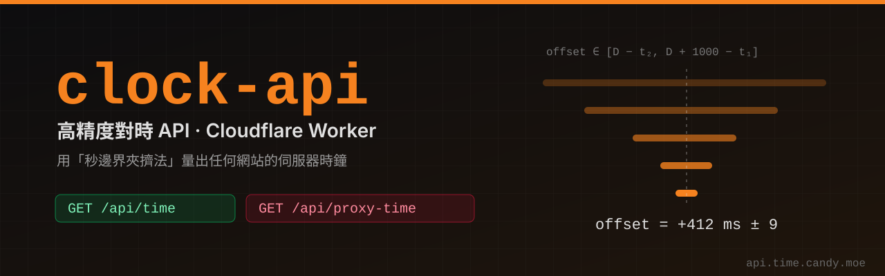
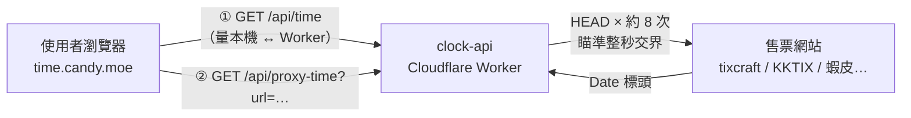

<p align="center">
  
</p>

<p align="center">
  <a href="https://time.candy.moe"></a>
  
  
  <a href="https://github.com/candy999/clock-worker-frontend"></a>
</p>

# clock-api

**[高精度決策時鐘](https://time.candy.moe) 的對時後端。** 一支部署在 Cloudflare Worker 上的小程式，做兩件事：

1. **給你一個準的時間**：回傳 Cloudflare 與 NTP 同步的時鐘，前端拿來校正你電腦／手機的時間。
2. **量出別人網站的時鐘**：售票網站、蝦皮這類網站的伺服器時間常常跟標準時間差了幾百毫秒。這支 API 會去「敲」目標網站，用 HTTP `Date` 標頭配上**秒邊界夾擠法**，把對方時鐘與標準時間的差量到約 ±RTT/2（通常是個位數到十幾毫秒）。

> 前端（時鐘畫面、倒數、懸浮時鐘、書籤小工具）在另一個專案：[candy999/clock-worker-frontend](https://github.com/candy999/clock-worker-frontend)。

## 目錄

- [為什麼需要它](#為什麼需要它)
- [架構](#架構)
- [API 端點](#api-端點)
- [原理：秒邊界夾擠法](#原理秒邊界夾擠法)
- [部署到 Cloudflare](#部署到-cloudflare)
- [設定](#設定)
- [本機開發](#本機開發)
- [安全與限制](#安全與限制)
- [更新紀錄](#更新紀錄)

## 為什麼需要它

搶票、搶購看的是**售票網站伺服器的時間**，不是你手機上的時間。兩者之間有兩層誤差：

| 誤差 | 來源 | 誰來量 |
|---|---|---|
| 你的裝置 ↔ 標準時間 | 系統時鐘漂移、沒開自動校時 | 前端呼叫 `/api/time`，自己算 |
| 標準時間 ↔ 售票網站 | 對方伺服器時鐘沒對準 | 這支 Worker 呼叫 `/api/proxy-time` 量 |

瀏覽器因為 CORS 讀不到別的網站的 `Date` 標頭，所以第二層一定要有一個伺服器端代為探測——這就是這支 Worker 存在的理由。

## 架構



前端最終使用的偏移量 = ①（本機 ↔ Worker）＋ ②（Worker ↔ 售票網站）。

## API 端點

### `GET /api/time`

回傳 Worker 當下的時間（毫秒 epoch）。**任何網域都能呼叫**（`Access-Control-Allow-Origin: *`），因為書籤小工具會直接在售票網站頁面上對時。

```bash
curl https://api.time.candy.moe/api/time
```

```json
{ "status": "success", "serverTime": 1731484800123 }
```

### `GET /api/proxy-time?url=<網址>`

量測目標網站時鐘與 Worker 時鐘的差，約需 **8 秒**。

| 參數 | 說明 |
|---|---|
| `url` | 必填。任何公開網址，只打網域也可以（`shopee.tw` 會自動補成 `https://shopee.tw`）。 |
| `rounds` | 選填。夾擠輪數，預設 `8`，上限 `12`。輪數越多越準，也越久。 |

```bash
curl "https://api.time.candy.moe/api/proxy-time?url=tixcraft.com"
```

```json
{
  "status": "success",
  "host": "tixcraft.com",
  "offset": 412.5,
  "uncertainty": 9,
  "workerTime": 1731484808456,
  "samples": [{ "rtt": 38, "status": 200, "age": 0, "warmup": true }, "…"],
  "targetTime": 1731484808869,
  "rtt": 18
}
```

| 欄位 | 說明 |
|---|---|
| `offset` | **目標網站時間 − Worker 時間**（毫秒）。正數代表對方的鐘比較快。 |
| `uncertainty` | 估計誤差 ±ms（夾擠區間寬度的一半）。 |
| `samples` | 每次探測的 RTT、HTTP 狀態、`Age` 標頭；`reset: true` 表示遇到時鐘不一致的後端而重新夾擠。 |
| `targetTime`、`rtt` | 舊版前端相容欄位。 |

失敗時回傳 `{ "status": "error", "message": "…" }`，HTTP 狀態 `400`（參數錯誤）或 `502`（目標網站量不到）。

## 原理：秒邊界夾擠法

HTTP `Date` 標頭只精確到**秒**，而且是無條件捨去，直接拿來用平均會慢 500 ms。這支 Worker 的做法：

1. 送出 HEAD 時記下 Worker 時間 `t1`，收到回應時記下 `t2`，回應的 `Date` 標頭為 `D`。
2. 目標網站蓋章那一刻的時間介於 `[D, D + 1000)`，而蓋章發生在 `[t1, t2]` 之間，所以
   **`offset ∈ [D − t2, D + 1000 − t1]`**。
3. 每次都等到「預測中的目標整秒交界」才送出下一個請求。回來的秒數有沒有進位，就能把區間砍掉約一半。
4. 重複幾輪，區間收斂到網路允許的極限（約 2 × 單程延遲）就停止，取區間中點當 `offset`。

另外還處理了幾個實務問題：

- **CDN 快取**：首頁常被快取，`Date` 是存進快取時的時間。Worker 會輪流試「首頁加亂數參數」「使用者給的網址」「不存在的隨機路徑」，挑第一個沒被快取（沒有 `Age` 標頭）的來用。
- **多台後端時鐘不一致**：區間出現矛盾時，保留最新一筆重新夾擠。
- **連線暖機**：第一次請求含 DNS／TCP／TLS 握手，只拿來找探測網址，不當正式樣本。
- **Worker 的凍結時鐘**：為了防範 Spectre，Worker 的 `Date.now()` 只在 I/O 之後前進；每次 `fetch` 前後都有 I/O，所以 `t1`、`t2` 是準的，就算偏舊也只會讓區間變寬（保守），不會變錯。

## 部署到 Cloudflare

> **順序：先部署 API，再部署前端。** 新版前端需要 API 回傳的 `offset` 欄位。

### 事前準備

- 一個 Cloudflare 帳號（免費方案即可，Workers 免費額度每天 10 萬次請求）。
- 如果要用自訂網域（例如 `api.time.candy.moe`），該網域要先託管在 Cloudflare（DNS 由 Cloudflare 管理）。
- Node.js 18 以上。

### 方法 A：用 Wrangler CLI 部署（推薦）

```bash
git clone https://github.com/candy999/clock-worker-API.git
```

```bash
cd clock-worker-API && npm install
```

```bash
npx wrangler login
```

**設定網域。** `wrangler.toml` 裡 `workers_dev = false`，所以 Worker 不會有 `*.workers.dev` 網址，一定要綁自訂網域才連得到。二選一：

- **寫在 `wrangler.toml`**（之後每次部署都會自動套用）：把檔案中 `routes` 那段的註解拿掉，改成你自己的網域：

  ```toml
  routes = [
    { pattern = "api.time.candy.moe", custom_domain = true }
  ]
  ```

- **或在 Dashboard 設定**：部署後到 **Workers & Pages → clock-api → Settings → Domains & Routes → Add → Custom domain**，填入 `api.time.candy.moe`。Cloudflare 會自動建立 DNS 紀錄與憑證。

> 只是想先試試看、還沒有網域：把 `workers_dev = false` 改成 `true`，部署後會得到 `https://clock-api.<你的子網域>.workers.dev`。

**部署：**

```bash
npm run deploy
```

**驗證：**

```bash
curl https://api.time.candy.moe/api/time
```

```bash
curl "https://api.time.candy.moe/api/proxy-time?url=kktix.com"
```

### 方法 B：連結 GitHub 自動部署（Workers Builds）

1. Cloudflare Dashboard → **Workers & Pages → Create → Import a repository**。
2. 選擇 `clock-worker-API` 這個 repo。
3. Build 設定：
   - **Build command**：留空（不需要建置）
   - **Deploy command**：`npx wrangler deploy`
   - **Root directory**：`/`
4. 建立後照上面的方式綁定自訂網域。之後每次推到 `main` 都會自動部署。

> Worker 的名稱以 `wrangler.toml` 的 `name = "clock-api"` 為準；如果 Dashboard 上建立的名稱不同，請改成一致，否則會部署成另一支 Worker。

## 設定

### 允許的前端網域（`ALLOWED_ORIGINS`）

`/api/proxy-time` 預設只允許 `https://time.candy.moe` 的頁面透過瀏覽器呼叫（另外永遠允許 `http://localhost`、`http://127.0.0.1` 方便開發）。**如果你把前端部署在自己的網域，一定要改這個設定**，否則瀏覽器會被 CORS 擋下。

在 `wrangler.toml` 加上（逗號分隔多個網域）：

```toml
[vars]
ALLOWED_ORIGINS = "https://time.example.com,https://clock-worker-frontend.pages.dev"
```

或在 Dashboard：**clock-api → Settings → Variables and Secrets → Add**，類型選 *Text*。

### 程式內的常數（`src/index.js`）

| 常數 | 預設 | 說明 |
|---|---|---|
| `DEFAULT_ALLOWED_ORIGINS` | `['https://time.candy.moe']` | 沒設定 `ALLOWED_ORIGINS` 時使用 |
| `PROBE_ROUNDS_DEFAULT` | `8` | 預設夾擠輪數 |
| `PROBE_ROUNDS_MAX` | `12` | `rounds` 參數上限 |
| `PROBE_TIMEOUT_MS` | `6000` | 單次探測逾時 |

## 本機開發

```bash
npm install
```

```bash
npm run dev
```

Wrangler 會在 `http://localhost:8787` 啟動，可以直接測試：

```bash
curl http://localhost:8787/api/time
```

```bash
curl "http://localhost:8787/api/proxy-time?url=shopee.tw"
```

搭配前端一起測時，把前端 `index.html` 裡的 `API_BASE` 暫時改成 `http://localhost:8787`。

## 安全與限制

- **只擋內網、不擋網站**：`/api/proxy-time` 可以探測任何公開網址，但拒絕 `localhost`、私有 IP（`10.x`、`172.16–31.x`、`192.168.x`、`100.64–127.x`、`169.254.x`）、`.local`／`.internal` 等位址，避免被拿來掃描內部網路。
- **只送 HEAD**：不讀取、不保存目標網站的內容；`redirect: 'manual'`，不跟隨轉址。
- **不留紀錄**：Worker 不寫任何資料庫，回應一律 `Cache-Control: no-store`。
- **`ALLOWED_ORIGINS` 是 CORS 限制**：它擋的是其他網站的頁面在瀏覽器裡呼叫，不是存取驗證；`curl` 之類的工具仍可直接呼叫。若要防止濫用，請在 Cloudflare 加上 [Rate Limiting 規則](https://developers.cloudflare.com/waf/rate-limiting-rules/)。
- **量不到的情況**：整個網站都是 CDN 快取的靜態頁（例如某些 S3 + CloudFront 架構）時會回傳錯誤，請改填該網站購票流程或 API 用的網域。

## 更新紀錄

### 2026-10

- **秒邊界夾擠法**：舊版直接拿 `Date` 標頭當時間，但它只精確到秒且被捨去，平均慢 500 ms。新版每次都瞄準「預測中的整秒交界」送 HEAD，用 `[D − t2, D + 1000 − t1]` 的交集逐步縮小範圍，最後收斂到約 ±RTT/2。
- **任何網址都能探測**（售票、蝦皮、日韓網站都可以），只擋本機與內網位址；瀏覽器呼叫端仍只限 `ALLOWED_ORIGINS`。
- **快取防護**：首頁、使用者給的網址、不存在的隨機路徑三種探測網址輪流試，挑第一個沒被 CDN 快取的來用；帶 `Age` 的回應一律丟棄。
- 每次探測 6 秒逾時，單次失敗會跳過。
- **`Timing-Allow-Origin`**：前端可以用 Resource Timing 把 DNS、TCP、TLS 與排隊時間從 RTT 中扣掉。
- **`Cache-Control: no-store`**。
- 保留舊欄位 `targetTime`、`rtt`，舊版前端仍可運作。

## 免責聲明

本專案只提供「時間」資訊，不會替你登入、下單或繞過任何網站的排隊與驗證機制。使用時請遵守各售票與購物網站的服務條款。
